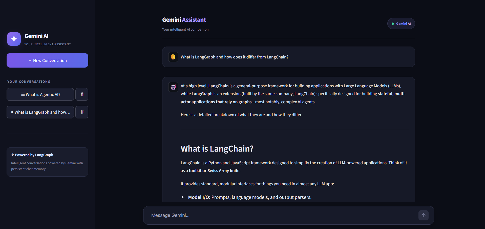
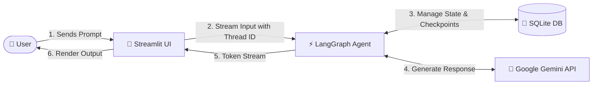

# ✦ LangGraph Gemini Chatbot

A conversational AI chatbot with persistent multi-thread chat history, token-by-token streaming, and a clean sidebar UI built with LangGraph, Google Gemini, and Streamlit.

[](https://www.python.org/)
[](https://streamlit.io/)
[](https://langchain-ai.github.io/langgraph/)
[](https://ai.google.dev/)
[](https://www.sqlite.org/)
[](LICENSE)

---

## 📸 Preview



---

## 🧠 How It Works

```
User Message
    │
    ▼
┌─────────────────┐
│  Streamlit UI    │  ──→  Manages threads, sidebar, and streaming display
│   (app.py)       │
└─────────────────┘
    │
    ▼
┌─────────────────┐
│  LangGraph       │  ──→  StateGraph compiles conversation flow
│  StateGraph      │       and manages message history per thread
│  (backend.py)    │
└─────────────────┘
    │
    ▼
┌─────────────────┐
│  SQLite          │  ──→  Persists all thread state to chatbot.db
│  Checkpointer    │       Survives app restarts
└─────────────────┘
    │
    ▼
┌─────────────────┐
│  Gemini API      │  ──→  Streams token-by-token responses
└─────────────────┘
```

### Key Design Decisions
- **LangGraph StateGraph**: conversation state is managed as a graph, enabling reliable multi-turn memory
- **SQLite persistence**: all threads saved locally, chat history survives restarts with no external database needed
- **Thread isolation**: each conversation is a separate thread with its own independent history
- **Streaming responses**: token-by-token output via Gemini API for a natural chat feel

---

## 🏗️ Architecture & Flow



1. **Frontend (`app.py`)**: Renders custom UI components, handles session state, manages conversation history, and invokes LangGraph's streaming endpoint.
2. **Backend (`backend.py`)**: Defines a compiled LangGraph `StateGraph`, attaches an `SqliteSaver` checkpointer, and synchronizes thread metadata with SQLite.
3. **Utilities (`utils.py`)**: Parses multimodal / message structures and maps LangChain roles to Streamlit chat components.

---

## 🛠 Tech Stack

| Component | Technology |
|---|---|
| LLM | Google Gemini (`gemini-2.5-flash`) |
| Agent Framework | LangGraph |
| LLM Integration | LangChain Google GenAI |
| State Persistence | SQLite via `langgraph-checkpoint-sqlite` |
| UI | Streamlit |
| Language | Python 3.10+ |

---

## ✨ Features

- 🔄 **Token-by-token streaming**: real-time response display
- 💾 **Persistent chat history**: all conversations saved to local SQLite database
- 🗂 **Multi-thread management**: create, switch between, and delete conversation threads
- 📌 **Auto-generated titles**: thread titles generated from the first message
- 🔃 **Sidebar sorted by recency**: most recent conversations always on top
- 🌙 **Dark-themed UI**: clean, minimal interface
- ⚠️ **Fallback handling**: graceful handling of rate limits and missing credentials

---

## 📁 Project Structure

```
├── app.py              # Streamlit frontend — UI, threads, streaming
├── backend.py          # LangGraph StateGraph and Gemini integration
├── utils.py            # Message parsing and role mapping
├── .streamlit/         # Streamlit theme configuration
├── screenshots/        # UI screenshots
├── requirements.txt
├── .env.example
└── README.md
```

---

## 🚀 Getting Started

### Prerequisites
- Python 3.10+
- Google AI Studio API key → [aistudio.google.com](https://aistudio.google.com)

### Installation

```bash
# 1. Clone the repository
git clone https://github.com/armankhan8150/langgraph-gemini-chatbot.git
cd langgraph-gemini-chatbot

# 2. Create a virtual environment
python -m venv venv
source venv/bin/activate  # Windows: venv\Scripts\activate

# 3. Install dependencies
pip install -r requirements.txt

# 4. Set up environment variables
cp .env.example .env
# Add your API key to .env
```

### Environment Variables

```env
GOOGLE_API_KEY=your_google_api_key
GEMINI_MODEL=gemini-2.5-flash-lite   # optional
CHATBOT_DB_PATH=chatbot.db           # optional
```

### Run

```bash
streamlit run app.py
```

---

## 🗺 Roadmap

- [ ] Export conversation history to Markdown or PDF
- [ ] Support for OpenAI and Mistral as alternative LLMs
- [ ] File and image upload support
- [ ] Deployed hosted version

---

## 👤 Author

**Arman Malik**: AI Engineer
[LinkedIn](https://linkedin.com/in/arman-malik) · [GitHub](https://github.com/armankhan8150)

---

## 📄 License

MIT License: see [LICENSE](LICENSE) for details.
