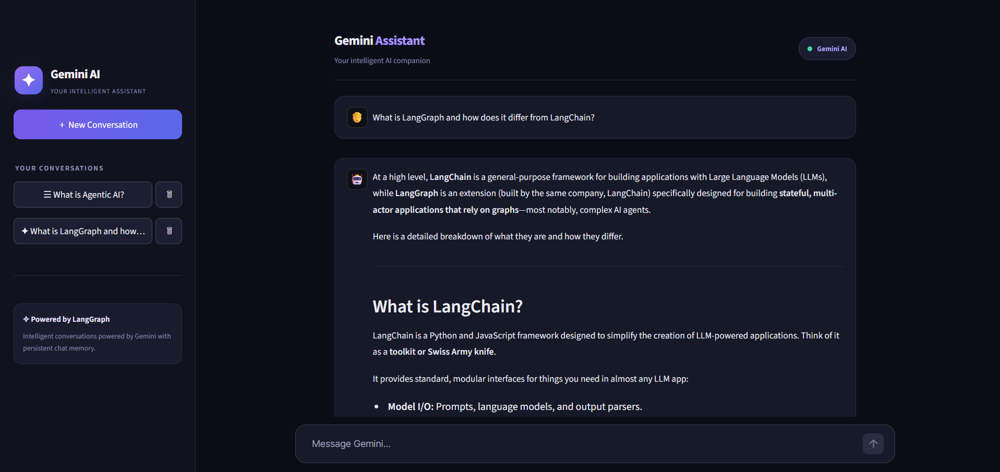
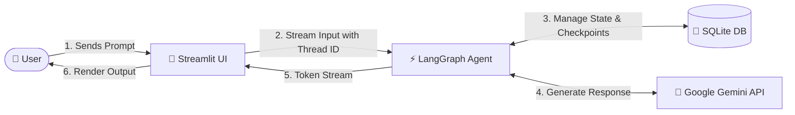

# ✦ LangGraph Gemini Chatbot

> A modern, stateful AI chat application built with **Streamlit**, **LangGraph**, and **Google Gemini**, featuring persistent SQLite checkpointer memory, real-time response streaming, and an elegant dark-mode interface.

[](https://www.python.org/)
[](https://streamlit.io/)
[](https://langchain-ai.github.io/langgraph/)
[](https://ai.google.dev/)
[](https://www.sqlite.org/)
[](LICENSE)

---

## 📸 Preview



---

## ✨ Key Features

- **⚡ Real-Time Token Streaming**: Streams Gemini replies chunk-by-chunk for smooth and responsive conversational interactions.
- **🧠 Persistent Multi-Thread Memory**: Uses LangGraph's `SqliteSaver` to persist entire conversation states across sessions in a local SQLite database (`chatbot.db`).
- **🗂️ Thread & History Management**:
  - Automatically titles conversation sessions using the first prompt.
  - Sidebar session list ordered by recent activity.
  - Switch seamlessly between saved sessions or start a new thread.
  - Delete individual threads along with their associated checkpoints.
- **🎨 Modern Dark Glassmorphism UI**: Custom CSS theme with rich purple accents, clean message bubbles, responsive input containers, and mobile optimization.
- **⚙️ Configurable Models**: Easily toggle or upgrade Gemini models (e.g., `gemini-3.5-flash-lite`, `gemini-1.5-pro`, `gemini-2.0-flash`) via environment variables.
- **🛡️ Resilient Error Handling**: Graceful fallback handling for API rate limits, network interruptions, or missing credentials.

---

## 🏗️ Architecture & Flow



1. **Frontend (`app.py`)**: Renders custom UI components, handles session state, manages conversation history, and invokes LangGraph's streaming endpoint.
2. **Backend (`backend.py`)**: Defines a compiled LangGraph `StateGraph`, attaches an `SqliteSaver` checkpointer, and synchronizes thread metadata with SQLite.
3. **Utilities (`utils.py`)**: Parses multimodal / message structures and maps LangChain roles to Streamlit chat components.

---

## 📁 Project Structure

```text
langgraph-gemini-chatbot/
├── .env.example              # Sample environment configuration file
├── .gitignore                # Ignored files (secrets, database, caches)
├── .streamlit/
│   └── config.toml           # Streamlit theme & layout configuration
├── app.py                    # Streamlit frontend & custom dark CSS styling
├── backend.py                # LangGraph StateGraph, SQLite checkpointer & thread manager
├── utils.py                  # Helper functions for message parsing & role mapping
├── requirements.txt          # Required Python packages
├── screenshots/
│   └── demo.png              # UI preview screenshot
└── chatbot.db                # SQLite database (auto-generated on first run)
```

---

## 🚀 Getting Started

### Prerequisites

- **Python 3.10+** installed on your system.
- A **Google Gemini API Key** from [Google AI Studio](https://aistudio.google.com/).

---

### 1. Clone the Repository

```bash
git clone https://github.com/armankhan8150/langgraph-gemini-chatbot.git
cd langgraph-gemini-chatbot
```

### 2. Create and Activate a Virtual Environment

**Windows (PowerShell):**
```powershell
python -m venv venv
.\venv\Scripts\Activate.ps1
```

**Windows (Command Prompt):**
```cmd
python -m venv venv
venv\Scripts\activate.bat
```

**macOS / Linux:**
```bash
python3 -m venv venv
source venv/bin/activate
```

---

### 3. Install Dependencies

```bash
pip install -r requirements.txt
```

---

### 4. Configure Environment Variables

Create a `.env` file in the project root by copying the template:

```bash
cp .env.example .env
```
*(On Windows Command Prompt, run: `copy .env.example .env`)*

Open `.env` and insert your Google Gemini API key:

```env
GOOGLE_API_KEY=your_actual_gemini_api_key_here

# Optional Configurations
GEMINI_MODEL=gemini-3.5-flash-lite
CHATBOT_DB_PATH=chatbot.db
```

---

### 5. Run the Application

Launch the Streamlit app:

```bash
streamlit run app.py
```

The application will automatically open in your default browser at `http://localhost:8501`.

---

## ⚙️ Configuration Options

You can customize the chatbot behavior by adding the following optional variables to your `.env` file:

| Variable | Default Value | Description |
| :--- | :--- | :--- |
| `GOOGLE_API_KEY` | *(Required)* | Your Google Gemini API Key from Google AI Studio. |
| `GEMINI_MODEL` | `gemini-3.5-flash-lite` | The Gemini model identifier to invoke. |
| `CHATBOT_DB_PATH` | `chatbot.db` | File path for SQLite persistence checkpoints and thread metadata. |

---

## 💡 How It Works

- **Starting a Conversation**: Click **`＋ New Conversation`** in the sidebar or start typing right away.
- **Automatic Titling**: The first message sent in a new conversation is used to generate an automatic title for that thread.
- **Switching Chats**: Select any conversation from the sidebar list to resume context and view past chat history.
- **Deleting Chats**: Click the **`🗑`** button next to any thread to delete its conversation record and checkpoints from the database.

---

## 🛠️ Tech Stack

- **UI Framework:** [Streamlit](https://streamlit.io/)
- **Orchestration & State Management:** [LangGraph](https://langchain-ai.github.io/langgraph/)
- **LLM Integration:** [LangChain Google GenAI](https://python.langchain.com/docs/integrations/chat/google_generative_ai/)
- **Model:** Google Gemini (`gemini-3.5-flash-lite`)
- **Persistence:** [SQLite](https://www.sqlite.org/) via `langgraph-checkpoint-sqlite`
- **Environment Management:** [python-dotenv](https://github.com/theskumar/python-dotenv)

---

## 🤝 Contributing

Contributions, issues, and feature requests are welcome!
Feel free to open an issue or submit a pull request:

1. Fork the Project
2. Create your Feature Branch (`git checkout -b feature/AmazingFeature`)
3. Commit your Changes (`git commit -m 'Add some AmazingFeature'`)
4. Push to the Branch (`git push origin feature/AmazingFeature`)
5. Open a Pull Request

---

## 📄 License

This project is open-source and licensed under the [MIT License](LICENSE).

---

## 🌟 Acknowledgements

- Built with [Google Gemini](https://ai.google.dev/)
- Agentic workflow powered by [LangGraph](https://github.com/langchain-ai/langgraph)
- UI powered by [Streamlit](https://streamlit.io/)
